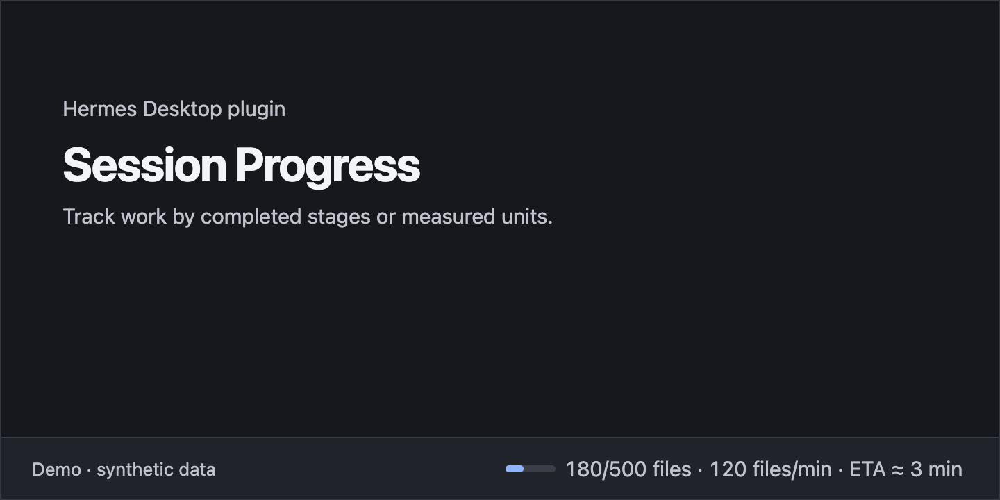

# Session Progress for Hermes Desktop

See how far the focused session has got without opening its checklist. Session Progress adds a horizontal bar, measured pace, and estimated time remaining to the bottom-right status bar. It leaves the project sidebar alone.



## Install and enable

Requires Hermes Desktop and Hermes Agent 0.23.2 or newer. Install from GitHub:

```sh
hermes plugins install ormeilu/hermes-session-progress --enable
```

In Desktop, open **Capabilities → Plugins → Session Progress** and turn on the **Desktop** switch if it is off. Use **Rescan** if the package is not listed yet. If you already installed `session-progress` manually as a standalone Desktop plugin, back up and move that standalone copy out of the Desktop plugin directory before using the packaged version. Otherwise Desktop keeps the standalone copy instead of replacing it.

## Track a session

- **Stages:** ask the agent to break the work into steps and update its checklist. The bar counts completed leaf tasks; cancelled tasks and group headings do not count.
- **Counts:** ask the agent to load `session-progress:session-progress-counter` and report actual counts after each batch. An explicit count such as `180/500 files` takes precedence over the stage count.
- **Tool progress:** if a tool reports a known total, the bar can show progress for that tool while it runs. This is labeled **Tool**; its total is not the session's total.

Use **Show session progress** in the command palette to see the complete readout. The bar is hidden until an eligible live update arrives. ETA uses the observed rate after a positive change measured over at least 10 seconds. It is not a model prediction. Changed totals, plan edits, and backward counts reset the sample; stale or stopped estimates are not shown. Rates are not restored after restart.

## Privacy and permissions

The Desktop component uses the public plugin SDK to observe live checklist and tool progress events. It holds derived progress and routing keys in memory and uses a five-second UI refresh timer for ETA. It does not make network requests, poll other profiles, read transcript history or credentials, write session data to disk, or spawn processes. The Agent component only registers the packaged instruction skill. It adds no tools, hooks, middleware, or dependencies.

## Verify locally

```sh
node --experimental-vm-modules --test desktop/smoke.test.mjs
hermes plugins validate . --install-deps
```

The Node tests use a stub SDK and synthetic events. License: MIT.
